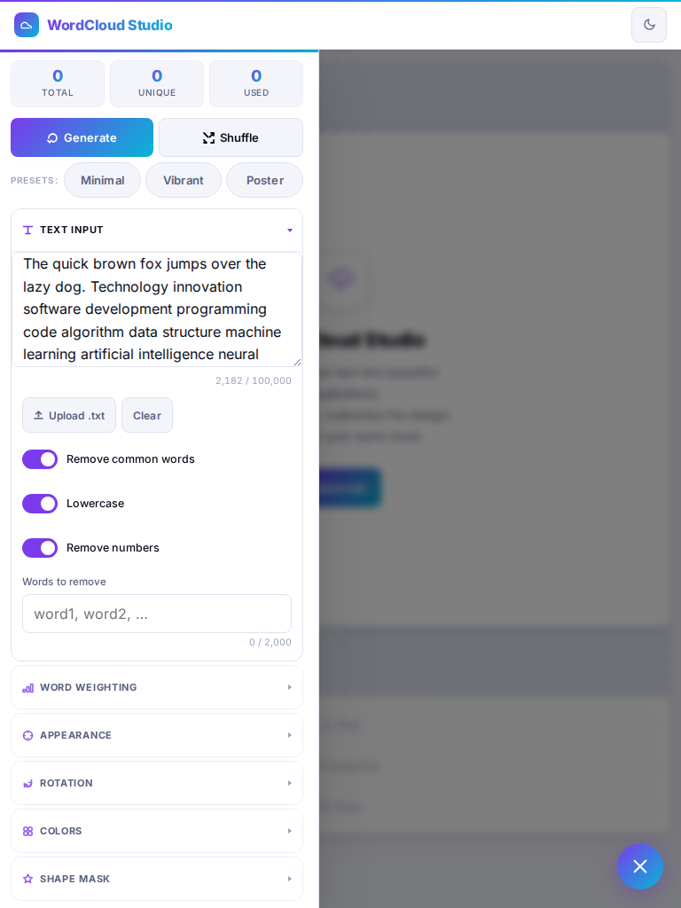
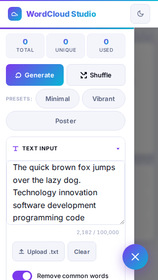

# WordCloud Studio

<p align="center">
  Create beautiful, customizable word clouds in seconds.
</p>

<p align="center">
  <a href="https://noahweidig.github.io/wordcloud/"><strong>Live Demo</strong></a>
  ·
  <a href="https://github.com/noahweidig/wordcloud/actions/workflows/deploy.yml"><strong>Deploy Workflow</strong></a>
</p>

<p align="center">
  <a href="https://github.com/noahweidig/wordcloud/actions/workflows/deploy.yml">
    
  </a>
  
  
  
</p>

---

## ✨ Preview



<p align="center">
  
</p>

## 🚀 Quick Start

```bash
npm install
npm run dev
```

Then open <http://localhost:5173>.

## 🧰 Scripts

| Command | What it does |
| --- | --- |
| `npm run dev` | Starts the local development server |
| `npm run lint` | Runs ESLint |
| `npm run build` | Type-checks and creates a production build |
| `npm run preview` | Serves the production build locally |

## 🌟 Features

- **Flexible input**: Paste text or upload a `.txt` file
- **Smart filtering**: Built-in English stopwords + custom stopwords
- **Word weighting**: Min threshold, max words, and linear/sqrt/log scaling
- **Styling controls**: Canvas size presets, background settings, font family/weight, spiral type, and padding
- **Rotation controls**: None, random (-30..30), fixed (0/90), with probability slider
- **Color modes**: Single color, palette cycling, frequency gradient, or random palette color (10 built-in palettes)
- **Shape masks**: Circle, heart, star, speech bubble, cloud, plus custom PNG uploads
- **Export options**: Download PNG (transparent or solid background), copy to clipboard
- **Presets + randomize**: Minimal, Vibrant, Poster, and one-click randomization
- **Live stats**: Total words, unique words, and words used in cloud

## 🧱 Project Structure

```text
src/
  utils/
    text.ts             # Tokenization, frequency counting, scaling
    stopwords.ts        # English stopword list
    palettes.ts         # Color palette definitions
    masks.ts            # Shape mask drawing and pixel-level masking
  hooks/
    useWordCloud.ts     # d3-cloud layout generation hook
  components/
    ControlPanel.tsx    # Left sidebar with all settings
    WordCloudCanvas.tsx # Canvas rendering + export logic
    ExportBar.tsx       # Download/copy buttons
  types.ts              # TypeScript types, defaults, presets
  App.tsx               # Main app layout and state
  App.css               # All styles
```

## 🛠️ Tech Stack

- React 19 + TypeScript
- Vite
- d3-cloud
- HTML Canvas

## 📝 Notes

- Works fully offline after install.
- Shape masks use post-render pixel clipping for reliable results with any shape.
- Word placement within masks is center-point filtered (words outside the mask are removed).

## 🗺️ Roadmap

- [ ] SVG export
- [ ] Stemming support
